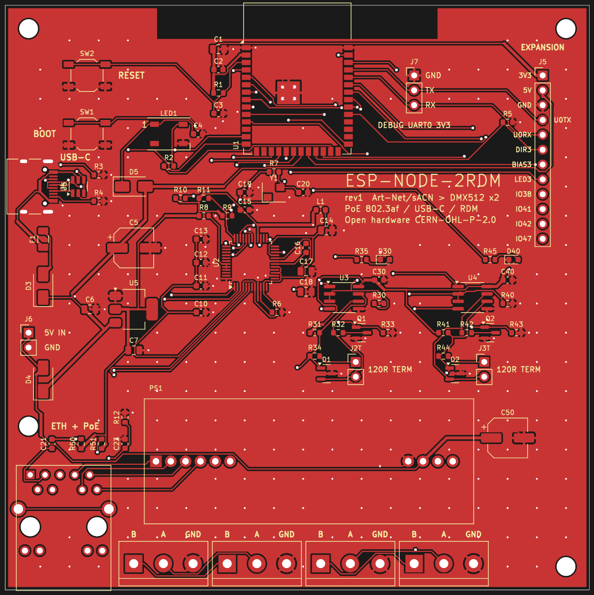
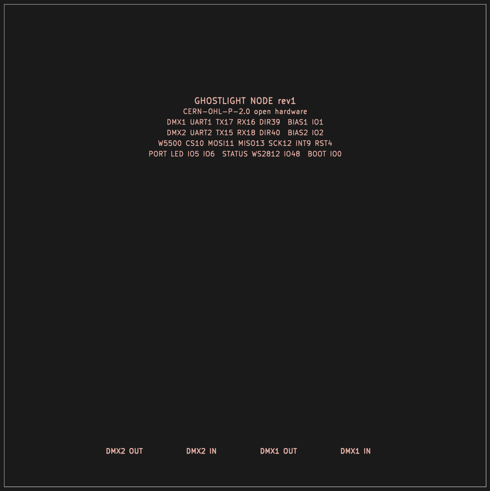

# 👻 Ghostlight Node

**A low-cost, open-source Art-Net / sACN → DMX512 node with PoE**

Two RDM-capable DMX ports · ESP32-S3 · W5500 Ethernet · 802.3af PoE · USB-C

-green)

[Docs](docs/) · [Wiki pages](wiki/Home.md) · [Ordering](docs/08-ordering-guide.md) · [Known issues](docs/11-known-issues-and-verification-status.md) · [Firmware](https://github.com/DefeatedWarrior/ghostlight-node-firmware)

| Front | Back (silkscreen only, mirrored) |
|---|---|
|  |  |

> **Status:** rev1 is design-complete but **has not been manufactured or tested**. Treat the first batch as a prototype run and read [known issues](docs/11-known-issues-and-verification-status.md) before ordering.

## Why

A *ghost light* is the single bulb left burning on an otherwise dark stage. The node does the same quiet job: it keeps the rig alive and listening while nothing else is on. The goal is a DMX node you can build for a small fraction of the cost of commercial units, with every file open.

## At a glance

| | |
|---|---|
| **Protocols** | Art-Net, sACN (E1.31), RDM |
| **DMX** | 2 bidirectional ports, SN65HVD72 (fail-safe for open/short/idle), TVS protected |
| **Per port** | IN and OUT 3-pole 5.08 mm terminals in parallel, 120 Ω jumper termination, GPIO-switchable bias |
| **MCU** | ESP32-S3-WROOM-1-N8 (8 MB flash, no PSRAM) |
| **Network** | WIZnet W5500, HR871150C PoE magjack, Wi-Fi also on module |
| **Power** | 802.3af PoE (SDAPO DP9700-5V, 5 V / 2 A), USB-C, or external 5 V |
| **I/O** | WS2812B status LED, LED per port, BOOT/RESET buttons, UART0 debug header |
| **Expansion** | 12-pin header J5 for a third port or other add-ons |
| **Board** | 100 × 100 mm, 2 layers, 1.6 mm, 4 × M3, hand-assembly friendly |

## Get started

1. **Order the PCB:** upload `fabrication/ghostlight-node-rev1-gerbers.zip` to JLCPCB (2 layers, 100 × 100 mm, 1.6 mm, HASL lead-free).
2. **Order parts:** import `bom/BOM_order_purchase.csv` into LCSC's BOM tool, scale for your board count, add about 10 % spare passives, check stock ([guide](docs/08-ordering-guide.md)).
3. **Assemble** by hand: [assembly guide](docs/09-assembly-guide.md).
4. **Bring up** in order (USB power, 3V3, Ethernet, DMX, then PoE): [test plan](docs/10-bring-up-and-test.md).
5. **Flash the firmware** from [ghostlight-node-firmware](https://github.com/DefeatedWarrior/ghostlight-node-firmware) with ESP-IDF 5.2.6: clone it, then run `tools/build.sh ghostlight-rev1 -p PORT flash monitor` ([firmware guide](https://github.com/DefeatedWarrior/ghostlight-node-firmware/blob/main/docs/DEVELOPING.md), [hardware notes](docs/13-firmware-integration.md)).

## Repository layout

| Path | Contents |
|---|---|
| `hardware/kicad/` | KiCad 7 project, `ESPNODE` symbol library and `ESPNODE.pretty` footprints |
| `fabrication/` | Gerber/drill zip for JLCPCB, individual gerbers, `pos.csv` |
| `bom/` | `BOM_order.csv` (per line, with designators), `BOM_order_purchase.csv` (LCSC part + quantity), `netlist.net` |
| `docs/` | Full documentation, schematic PDF, images |
| `wiki/` | Wiki pages (Home, FAQ, troubleshooting...) ready to publish to the GitHub wiki |
| `tools/generator/` | Python scripts that generated the board (reference only) |

## Documentation

| Build it | Understand it | Use it |
|---|---|---|
| [07 BOM and sourcing](docs/07-bom-and-sourcing.md) | [01 Overview and specs](docs/01-overview-and-specifications.md) | [13 Firmware integration](docs/13-firmware-integration.md) |
| [08 Ordering guide](docs/08-ordering-guide.md) | [02 Architecture and power](docs/02-architecture-and-power.md) | [05 DMX ports](docs/05-dmx-ports.md) |
| [09 Assembly guide](docs/09-assembly-guide.md) | [03 Pin map and connectors](docs/03-pinout-and-connectors.md) | [06 USB and debug](docs/06-usb-programming-debug.md) |
| [10 Bring-up and test](docs/10-bring-up-and-test.md) | [04 Ethernet and PoE](docs/04-ethernet-and-poe.md) | [11 Known issues](docs/11-known-issues-and-verification-status.md) |
| [14 Regenerating the design](docs/14-regenerating-the-design.md) | [12 PCB design notes](docs/12-pcb-design-notes.md) | [15 Roadmap / rev2](docs/15-roadmap.md) |

The schematic is in [docs/schematic.pdf](docs/schematic.pdf).

## Firmware

The firmware is in its own repository, [ghostlight-node-firmware](https://github.com/DefeatedWarrior/ghostlight-node-firmware): ESP-IDF, MIT, originally ESP-NODE-2RDM by ThinhCNTT22. It has a board profile for rev1 (8 MB flash, no PSRAM, 8 MB partition table, port LEDs on GPIO5/6, DMX bias switches, W5500 reset), plus profiles for the N16R8 dev-board prototype and a plain ESP32 DevKitC. Optional features (sACN, RDM, scenes, DMX tools, web log, mDNS, Ethernet) can be switched off at build time. The firmware builds with ESP-IDF 5.2.6 for this board (`tools/build.sh ghostlight-rev1`) with no warnings, and CI builds it on every change. **It has not been run on a Ghostlight board yet**; the same firmware runs on the N16R8 dev-board prototype. The firmware still calls itself `ESP-NODE-2RDM` in places. See its [DEVELOPING.md](https://github.com/DefeatedWarrior/ghostlight-node-firmware/blob/main/docs/DEVELOPING.md).

## Contributing

See [CONTRIBUTING.md](CONTRIBUTING.md). Results from a built board (photos, scope captures, what broke) are the most valuable contribution.

## Licence

Hardware files: **CERN-OHL-P-2.0** ([LICENSE](LICENSE)). Firmware: MIT ([ghostlight-node-firmware](https://github.com/DefeatedWarrior/ghostlight-node-firmware/blob/main/LICENSE)).

"Ghostlight Node" has not been trademark-cleared; check your own country's register before selling boards under it. Art-Net is a trademark of Artistic Licence Engineering Ltd; ESP32 of Espressif Systems; W5500 of WIZnet. Names are used only to describe compatibility.
