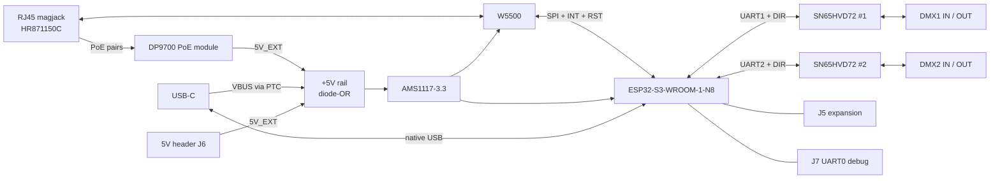

# 1. Overview and specifications

ESP-NODE-2RDM receives lighting data over the network (Art-Net or sACN over Ethernet, optionally Wi-Fi) and outputs it as DMX512 on two physical ports. Both ports use half-duplex RS-485 with direction control, so the hardware supports RDM (discovery and responder) as well as plain DMX output or input. Whether a given feature works is decided by the firmware.

## Specifications

| Item | Value |
|---|---|
| Board size | 100 x 100 mm, 2 layers, 1.6 mm FR-4 |
| Mounting | 4 x M3 holes: (4, 4), (96, 4), (4, 72), (96, 96) mm from the lower-left board corner as drawn in the board file |
| MCU | ESP32-S3-WROOM-1-N8 (dual-core, 8 MB quad flash, no PSRAM, 2.4 GHz Wi-Fi + BLE, PCB antenna) |
| Ethernet | WIZnet W5500 over SPI, 10/100 Mbps, HR871150C RJ45 magjack |
| PoE | IEEE 802.3af powered device, SDAPO DP9700-5V module, 37-57 V in, 5 V / 2 A out, 1.5 kV isolation (module spec) |
| DMX ports | 2 x RS-485, SN65HVD72 (3.0-3.6 V, 250 kbps), IN + OUT screw terminal per port, switchable bias, jumper termination, SM712 TVS |
| USB | USB-C receptacle, native ESP32-S3 USB (device only), USBLC6-2SC6 ESD protection |
| Power inputs | USB VBUS (through 1.1 A PTC), 5 V header J6, PoE module output |
| Regulator | AMS1117-3.3 LDO from the combined +5 V rail |
| Indicators | WS2812B status LED, per-port LED (GPIO), RJ45 link / activity LEDs, none for power |
| Buttons | BOOT (GPIO0), RESET (EN) |
| Debug | UART0 header J7 (3.3 V logic), USB-C |
| Expansion | J5, 12 pin 2.54 mm header |
| Isolation | **None** between DMX ports, USB and logic (only the PoE input is isolated) |
| Assembly | Hand assembly; smallest SMD parts are 0603 and the W5500 LQFP-48 (0.5 mm pitch) |
| Licence | CERN-OHL-P-2.0 |

## Design goals

- **Cheap**: one 100 x 100 mm board (the cheapest fabrication tier), commodity LCSC parts, no 4-layer stack, no isolated RS-485 parts.
- **Hand-assemblable**: nothing smaller than 0603, no BGAs or QFNs.
- **Firmware-compatible**: GPIO assignments match the existing firmware (see [docs/03](03-pinout-and-connectors.md)).
- **Flexible**: IN and OUT terminals per port, jumper-selectable termination, GPIO-switchable bias, a 12-pin expansion header for a third port or other add-ons.

## Non-goals for rev1

- No galvanic isolation on the DMX side. A ground fault or a miswired fixture can damage the board and anything connected to its USB port.
- No built-in XLR connectors. Use the screw terminals with leads to panel-mount XLRs.
- No microSD, display or RTC (J5 can be used for add-on boards).

## Block diagram

