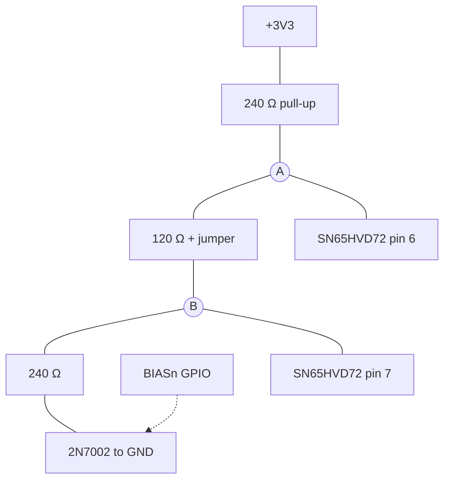

# 💡 DMX Ports

Two identical ports. Each uses one **SN65HVD72DR** (3.3 V, half-duplex, 250 kbps) with its fail-safe receiver for **open, shorted and idle** buses, which keeps the RX line quiet during RDM listen windows.

| Part | DMX1 | DMX2 |
|---|---|---|
| Transceiver | U3 | U4 |
| TVS (SM712) | D1 | D2 |
| Bias resistors 240 Ω | R31, R32 | R41, R42 |
| Bias switch (2N7002) | Q1 | Q2 |
| Termination 120 Ω | R34 | R44 |
| Termination jumper | J2T | J3T |
| IN / OUT terminals | J2 / J2O | J3 / J3O |
| Port LED | D30 | D40 |
| MCU pins | UART1 TX17 RX16 DIR39 | UART2 TX15 RX18 DIR40 |

- **DIR** drives /RE and DE together. High = transmit, low = receive. A 10 kΩ pull-down keeps the port receiving while the MCU is in reset.
- **Bias:** BIAS1/BIAS2 (GPIO1/2) high turns on a 240 Ω pull-up on A and a 240 Ω pull-down on B. Off by default.
- **Termination:** a shunt on J2T/J3T puts 120 Ω across A and B. Only on the **last** device of a line.
- **Protection:** SM712 per port (-7 V to +12 V). No isolation, no series fuse.

> [!NOTE]
> Bias values were chosen by the designer, not taken from the E1.20 text. Expect about 0.6 V idle differential into a terminated line and about 5.5 mA bias current. Check with a scope.

See [[DMX Wiring]] for cabling and XLR.
