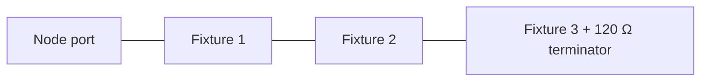

# 🎛️ DMX Wiring

Terminal order, left to right as silkscreened: **B, A, GND**.

| Board terminal | XLR pin | Signal |
|---|---|---|
| GND | 1 | Shield / common |
| B | 2 | Data − (as labelled) |
| A | 3 | Data + (as labelled) |

5-pin XLR pins 4 and 5 are not connected.

> [!WARNING]
> **A/B polarity is not verified on hardware.** RS-485 vendors disagree on which line is "A". Test with a known-good fixture or a DMX tester; if the fixture does not respond, swap the two wires.

## IN and OUT

IN and OUT on a port are two terminals on the **same bus** (A to A, B to B, GND to GND). They are not a repeater. A port is a source **or** a sink for the whole port, and a daisy chain continues from the OUT terminal.

## Good practice

- Use DMX or RS-485 cable (120 Ω twisted pair), not microphone cable, for long runs.
- Terminate **only** the last device. On the node, fit the J2T/J3T shunt only if the node is last.
- Keep stubs short; daisy chain rather than T-splitting.
- Enable bias only if no other device on the line provides it.
- Watch for ground loops between USB and a lighting rig on a different earth ([[Power]]).
