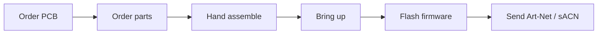

# 🚀 Getting Started

## 1. Get the files

Clone the repository or download it. You need `fabrication/`, `bom/` and `firmware/`.

## 2. Order the PCB

Upload `fabrication/ghostlight-node-rev1-gerbers.zip` to JLCPCB (2 layers, 100 × 100 mm, 1.6 mm, HASL lead-free). Details in [[Ordering Guide]].

## 3. Order the parts

Import `bom/BOM_order_purchase.csv` into LCSC's BOM tool, set the quantity to your board count, add about 10 % spare passives. **Check stock first**: the PoE module had very low stock when last checked. See [[Bill of Materials]].

## 4. Assemble and bring up

Hand-assemble following [[Assembly Guide]], then power it up in the order in [[Bring-up Checklist]]. PoE goes last.

## 5. Flash and use

Install ESP-IDF, delete any old `sdkconfig`, build and flash `firmware/` ([[Firmware]]). Then open the web interface ([[Using the Node]]).

## 🧰 What you need

| Tool | Why |
|---|---|
| Temperature-controlled iron, flux, 0.5 mm solder, braid | all soldering |
| Hot air or hotplate (recommended) | W5500, ESP32 module, USB-C |
| Magnification | 0.5 mm pitch parts |
| Multimeter | short checks and rail voltages |
| Oscilloscope or logic analyser (recommended) | DMX A/B polarity, bias, timing |
| 802.3af PoE switch or injector | PoE test only |
| 3.3 V USB-UART adapter (optional) | J7 debug console |
| DMX tester or fixture, Art-Net/sACN source | functional test |
