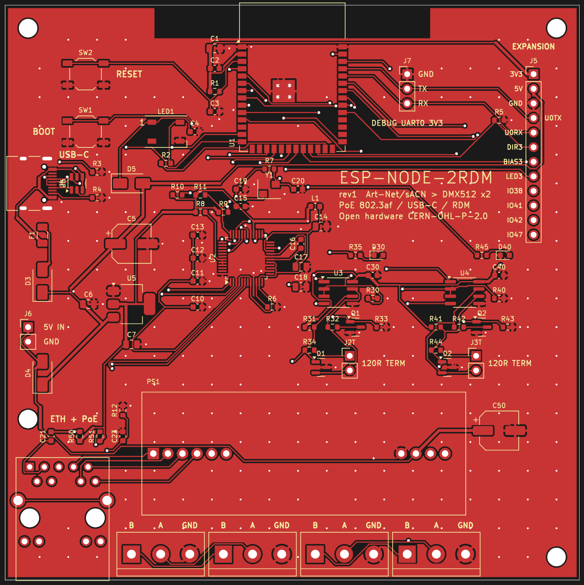
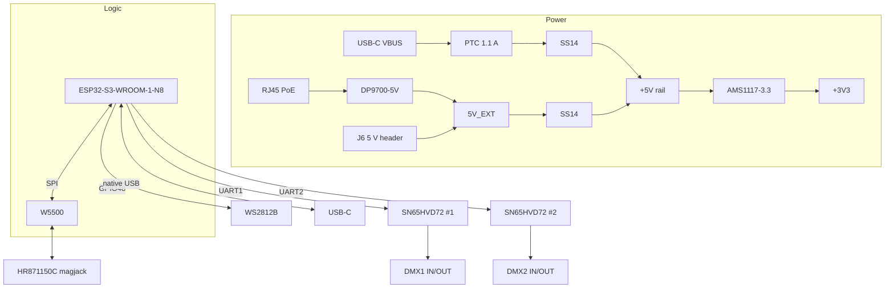
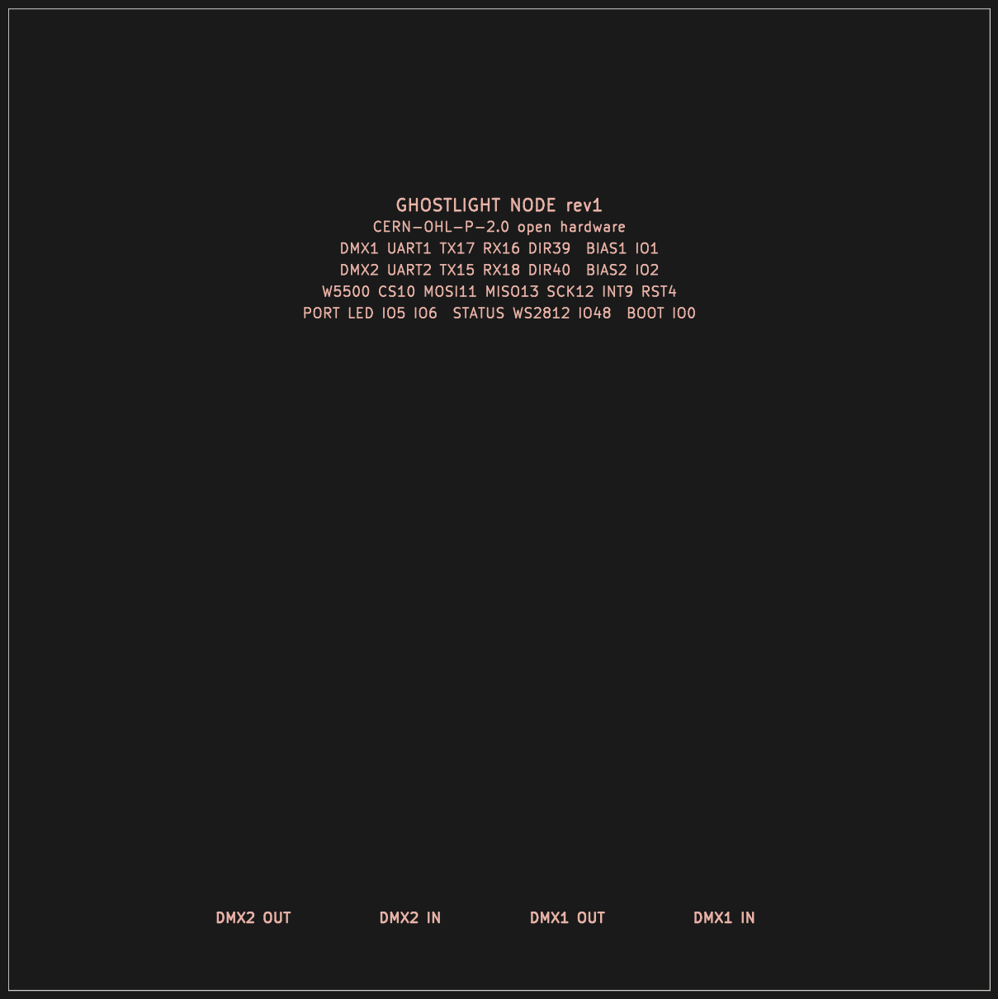

# 🔧 Hardware Overview

## Block diagram

## Main parts

| Block | Part | Ref |
|---|---|---|
| MCU | ESP32-S3-WROOM-1-N8 | U1 |
| Ethernet | W5500, 25 MHz crystal | U2, Y1 |
| Jack | Hanrun HR871150C | J1 |
| PoE | SDAPO DP9700-5V | PS1 |
| DMX transceivers | SN65HVD72DR | U3, U4 |
| DMX TVS | SM712 | D1, D2 |
| 3.3 V regulator | AMS1117-3.3 | U5 |
| USB ESD | USBLC6-2SC6 | U6 |
| Status LED | WS2812B | LED1 |

## Board layout

| Front | Back (silkscreen, mirrored) |
|---|---|
|  |  |

The back silkscreen carries the GPIO map, licence and revision.

## Design choices

- **Hand assembly:** 0603/0805 passives, SOIC-8, LQFP-48. No BGA, no fine-pitch QFN.
- **Cost:** the N8 module (no PSRAM) and a single-chip PoE module keep the BOM small.
- **IN and OUT per port:** two terminals in parallel on one transceiver for daisy chaining.
- **Expansion:** header J5 for a third port or other add-ons.

More detail: [`docs/12-pcb-design-notes.md`](https://github.com/DefeatedWarrior/ghostlight-node/blob/main/docs/12-pcb-design-notes.md).
