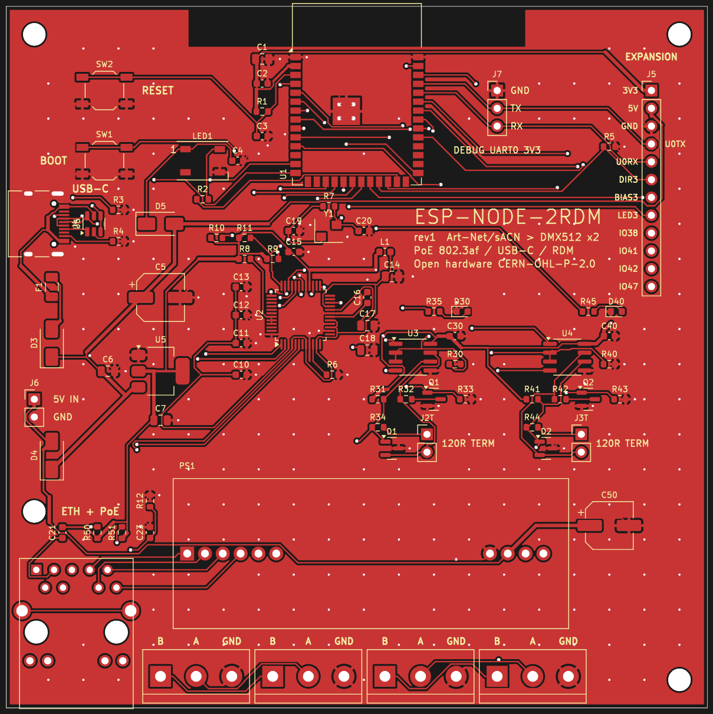

# 👻 Ghostlight Node

**Open-source Art-Net / sACN → DMX512 node with PoE**

2 × RDM-capable DMX ports · ESP32-S3 · W5500 Ethernet · 802.3af PoE · USB-C

  

> [!WARNING]
> **rev1 has not been manufactured or tested.** Treat the first batch as a prototype run. See [[Known Issues]] before ordering.

A *ghost light* is the single bulb left burning on a dark stage. This node does the same quiet job: it keeps the rig alive and listening. The goal is a DMX node you can build for a fraction of the price of commercial units, with every file open.

## 🧭 Where to go

| I want to... | Go to |
|---|---|
| **Build one** | [[Getting Started]] → [[Ordering Guide]] → [[Assembly Guide]] → [[Bring-up Checklist]] |
| **Understand the hardware** | [[Hardware Overview]] · [[Power]] · [[Ethernet and PoE]] · [[DMX Ports]] · [[USB and Debug]] |
| **Wire it up** | [[Pin Map]] · [[Connectors]] · [[DMX Wiring]] |
| **Flash and use it** | [[Firmware]] · [[Using the Node]] |
| **Buy the parts** | [[Bill of Materials]] |
| **Fix a problem** | [[Troubleshooting]] · [[FAQ]] |
| **Help improve it** | [[Known Issues]] · [[Roadmap]] · [[Contributing]] |

## ⚡ Quick facts

| | |
|---|---|
| **Protocols** | Art-Net, sACN (E1.31), RDM (firmware) |
| **DMX** | 2 bidirectional ports, SN65HVD72 transceivers, TVS protected |
| **MCU** | ESP32-S3-WROOM-1-N8 (8 MB flash, no PSRAM) |
| **Network** | WIZnet W5500 + HR871150C PoE magjack; Wi-Fi on the module |
| **Power** | 802.3af PoE, USB-C, or external 5 V |
| **Board** | 100 × 100 mm, 2 layers, 4 × M3 holes, hand-assembly friendly |
| **Cost** | about USD 14-15 for the main parts before passives, PCB and shipping (snapshot) |
| **Licence** | Hardware CERN-OHL-P-2.0, firmware MIT |

Source: [https://github.com/DefeatedWarrior/ghostlight-node](https://github.com/DefeatedWarrior/ghostlight-node)
