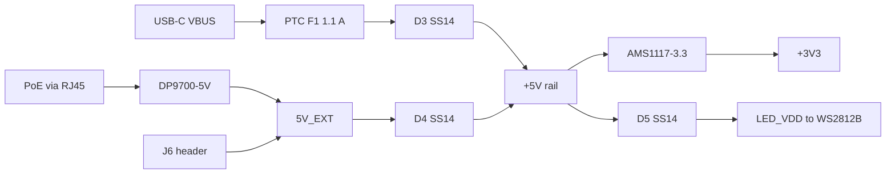

# 🔌 Power

## Power tree

- **Diode-OR:** USB (via D3) and `5V_EXT` (via D4) feed `+5V`, so they never back-feed each other.
- **+5V is not a clean 5.0 V:** it is the source minus one SS14 drop, about **4.5-4.7 V** loaded. This is also what J5 pin 2 provides.
- **3.3 V:** AMS1117-3.3 with 10 µF in and 22 µF out.
- **Bulk caps:** C5 and C50, 220 µF 6.3 V (thin margin, see [[Roadmap]]).

> [!CAUTION]
> The PoE module output and the J6 header are the **same net** (`5V_EXT`) with no diode between them. **Use only one of them at a time.** Never put an external supply on J6 while PoE is powering the board.

## Current budget (estimates, verify on the bench)

| Load | Typical | Peak |
|---|---|---|
| ESP32-S3 (Wi-Fi TX) | 100-150 mA @ 3.3 V | 350-400 mA |
| W5500 | ~130 mA @ 3.3 V | ~150 mA |
| 2 × SN65HVD72 + bias | < 20 mA | ~25 mA each driving, +5.5 mA bias |
| WS2812B | 1-10 mA | 60 mA white |

The 3.3 V rail can reach roughly 500-600 mA at peaks, or 0.6-0.8 A on the 5 V side. That is **more than a default 500 mA USB port**. On USB alone expect brownouts with Wi-Fi and Ethernet both busy. Use PoE or an external 5 V supply for real use.

## Grounding and protection

- One `GND` plane joins USB, DMX and logic. Nothing isolates DMX from USB, so a laptop on USB plus a long DMX run at a different earth can create a ground loop. Use an isolated USB hub, or see isolated DMX in the [[Roadmap]].
- The PoE module is isolated (1.5 kV per its datasheet). The RJ45 shield (`CHASSIS`) ties to GND through 10 nF and 1 MΩ in parallel.
- USB has a USBLC6-2SC6; each DMX port has an SM712 TVS. There is no extra surge protection on the 5 V inputs beyond the USB PTC.
